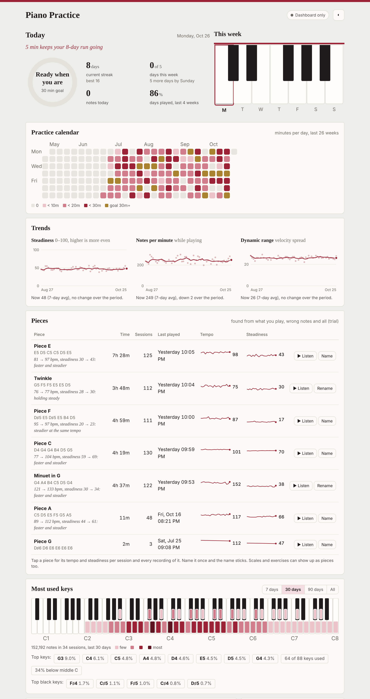
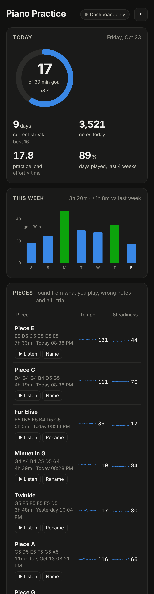
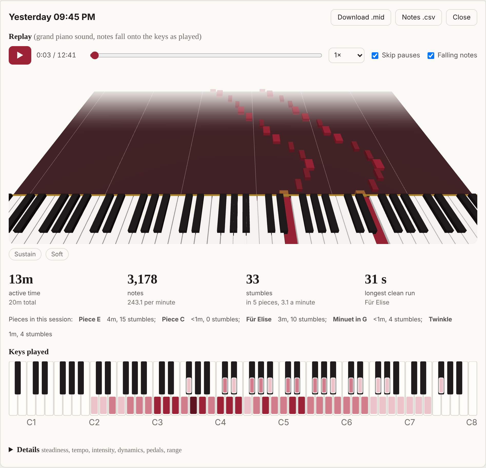
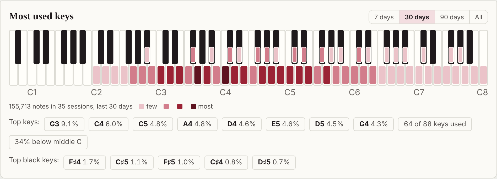
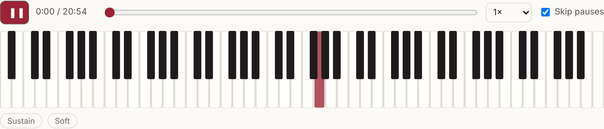
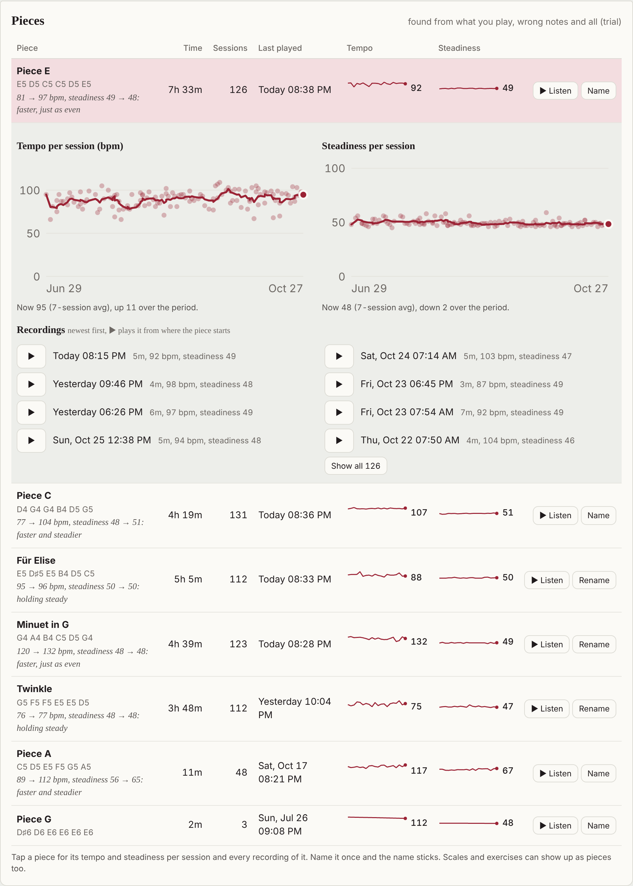
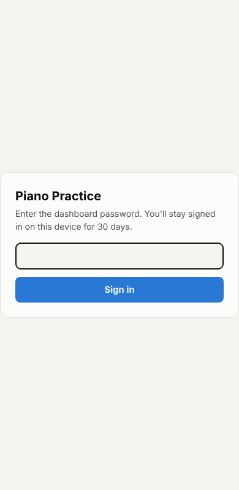
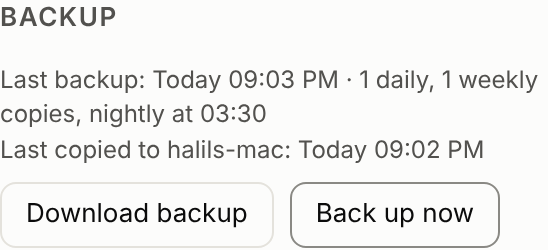

# pianotrack

A headless practice tracker for a digital piano, built for a Roland FP-30X plugged
into a Raspberry Pi over USB. The Pi records every note you play, splits it into
practice sessions, and serves a fitness-band style dashboard on your home network.
No phone app, no cloud, no extra Python packages.



<p>
  
  
</p>

## What it tracks

| Metric | What it means |
|---|---|
| Active time | Time actually playing. Pauses longer than 3 s stop the clock, so reading the score doesn't count. |
| Daily goal ring, streak, consistency | Minutes against your goal, consecutive days with at least 5 min, and the share of the last 28 days you played. |
| Notes, notes per minute | Volume of playing and how dense it was while playing. |
| Effort zones | Like heart-rate zones: time spent at Rest / Light / Moderate / Vigorous / Peak note density. |
| Intensity and load | A 0 to 100 effort figure from density and loudness, and load = active minutes × intensity / 50. |
| Steadiness, est. tempo | How evenly notes land on a rhythmic grid (100 = metronomic; about 70 means a typical ±10 ms wobble), plus the dominant tempo. |
| Dynamics | Mean velocity, pp to ff distribution, and dynamic range (spread between the quiet and loud 10%). |
| Keys | 88-key map per session and across the last 7, 30 or 90 days or all time: keys keep their piano colours and a coloured band on each key, white or black, shows how much it was played (tap a key for its count). Top keys, top black keys, lowest and highest note, share of notes below middle C. |
| Pedal | Sustain presses and share of time on sustain, soft pedal presses and share of time. |
| Pieces | Per piece: active time, sessions, last played, and per-session tempo and steadiness (active-time weighted over the stretches of that piece). |

**On a phone** the page puts what changes day to day first: Today, This week, Pieces and
recent sessions, then the slower views (trends, calendar, keys, records). Steadiness,
notes per minute and dynamic range share one **Trends** card; on a phone, tabs switch
between them, on a wider screen all three show side by side. Pieces fit the phone
width, with time, last played, Listen and Name under each piece's name.

**The look** follows [docs/DESIGN.md](docs/DESIGN.md): a practice room rather than a gym.
Felt claret and brass on plaster and ivory (rosewood in dark mode), serif headings and
figures (New York on Apple devices), goal-met days in brass, and a felt focus ring for
keyboard use.

Tempo, steadiness and intensity are heuristics for following trends over weeks,
the same way a band's calorie count is. They are not a teacher's grade.





**Session replay:** open any session and press play to hear it back with a grand piano
sound while the keyboard lights up the keys as you pressed them. Sustain and soft pedal
are honoured, playback speed goes from 0.5× to 2×, and "skip pauses" squeezes long
silences so you hear only the playing. The piano samples ship with the app, so replay
works without internet.

Every session can be downloaded as a `.mid` file (handy for replaying what you
played) or as a CSV of notes. `/api/sessions.csv` exports the session list.

**Backups:** the whole history is copied every night (7 daily and 4 weekly copies), can
be pulled onto a Mac automatically, downloaded from the dashboard, and restored with one
command. See [Backups](#backups).



**Pieces (trial):** the dashboard groups the stretches of playing that are the same
piece, found from the notes alone, with wrong notes, restarts, slow tempos and all.
Nothing to log. Each piece shows its total time, sessions and when you last played it,
and its tempo and steadiness per session (tap a piece for the charts). From 10 sessions
on, a line under the piece compares its first 5 sessions with its last 5 (medians), e.g.
"153 → 109 bpm, steadiness 59 → 69: slowed down to clean up". Pieces show as
"Piece A, B…" with their most played phrase; **Listen** jumps the replay to that phrase
so you can recognise it, and **Name** names it once ("Chopin waltz"). The name follows
the music into later sessions. A session's detail lists the pieces played in it.
A session that closes after everything already grouped is added to the existing
pieces instead of regrouping the whole history (under a second instead of about 17 s with 400
days of practice); a deleted or out-of-order session regroups from scratch.
Grouping never changes your recordings: replay, `.mid` and `.csv` stay exactly as
recorded; only the names you give are stored. Scales and exercises can show up as
pieces too. See [docs/pieces-matcher.md](docs/pieces-matcher.md) for how matching works
and how well it does. `python3 -m pianotrack pieces` prints the same grouping as a
read-only report.

## How it works

```
FP-30X ──USB──▶ /dev/snd/midiC1D0 ──▶ collector ──▶ recorder ──▶ SQLite
                                                                   │
                     phone / laptop on wifi ◀── dashboard + API ◀──┘
```

* **Collector** (`collector.py`) reads the ALSA raw MIDI device directly and parses
  the byte stream itself (`midi.py`). If the piano is switched off, it waits and
  reconnects when it comes back.
* **Recorder** (`recorder.py`) opens a session on the first note and closes it after
  3 minutes of silence. Sessions with fewer than 8 notes are discarded. Notes are
  written in batches every 2 s to spare the SD card.
* **Metrics** (`metrics.py`) are computed when a session closes and stored with it.
* **Pieces** (`pieces.py`) cuts sessions into segments at pauses of 3.5 s, takes the
  melody (top voice), and matches segments by shared runs of pitch intervals. Pieces heard
  3+ times are listed, recomputed from the raw notes after each new session.
* **Store** (`store.py`) keeps everything in one SQLite file. Its schema carries a version
  number (`PRAGMA user_version`); schema changes are added as numbered steps and an older
  database is upgraded when it opens, while a database from a newer version is refused.
* **Server** (`server.py`) serves the dashboard and a JSON API on port 8080, plus a
  localhost-only entrance on 8081 for the remote link (see below).
* **Backups** (`backup.py`) copy the database every night (see below).

Data never leaves your home. The SQLite file lives at `/var/lib/pianotrack/pianotrack.db`
when installed as a service.

## Install on the Raspberry Pi

Needs Raspberry Pi OS (Bookworm or newer, Python 3.9+). Nothing to `pip install`.

```bash
sudo apt install -y git
git clone https://github.com/kiracih/pianotrack.git
cd pianotrack
python3 -m pianotrack devices      # the FP-30X should be listed
./deploy/install.sh                # installs and starts the systemd service
```

Then open `http://<pi-hostname>.local:8080` (for example `http://raspberrypi.local:8080`)
on any device on the same wifi. Add it to your phone's home screen and it opens full screen with its own icon.

At boot the service waits up to 90 seconds for the clock to sync over the network,
because the Pi has no battery-backed clock and session times would otherwise be
wrong just after boot. If the Pi is offline it starts anyway.

Useful commands:

```bash
journalctl -u pianotrack -f        # live log: "opened session", "closed session"
sudo systemctl restart pianotrack
git pull && sudo systemctl restart pianotrack    # update
```

If `devices` shows nothing, check `aconnect -l` and `cat /proc/asound/cards`. The
FP-30X needs to be connected with its **USB to Host** port. Only one program can
open a raw MIDI port at a time, so stop anything else reading the piano.

## Reach it from outside your home

`deploy/install-tunnel.sh` publishes the dashboard through a Cloudflare
[Quick Tunnel](https://developers.cloudflare.com/tunnel/get-started/quick-tunnels/): no
Cloudflare account, domain or router change needed.

```bash
./deploy/install-tunnel.sh
```

Then open the dashboard at home and set a password under **Remote access**. Until a
password exists, anything coming through the tunnel is refused. Visitors through the
tunnel see a sign-in page once per device and stay signed in for 30 days; on the home
network no password is asked. Five wrong attempts lock that visitor out for 15 minutes,
and 20 wrong attempts from anywhere within an hour pause all sign-ins for a while.
Setting a new password, or **Sign out all devices** (in Remote access at home, or in the
footer of a signed-in remote visit), signs every device out. The password can only be set
or changed from the home network.



How it tells the two apart: cloudflared connects to a second port, 8081
(`--tunnel-port`), which listens only on the Pi itself, and every request on that port
needs the password. On the home port, 8080, a request still counts as remote when it
carries Cloudflare headers (`Cf-Ray`, `Cf-Connecting-Ip`) or comes from an address
outside the home network, so opening 8080 to the internet by mistake would not skip the
password.

The home network itself is protected from web pages: any site you visit could make your
browser send requests to the Pi, so without a password the Pi still only answers
requests addressed to it by IP, as `pi4.local` or `localhost`, or by its hostname (add
others with `--allowed-host`), and only accepts changes sent as JSON by its own pages.

The link is a random `https://….trycloudflare.com` address that **changes whenever the
tunnel restarts** (for example after a reboot). The dashboard footer shows the current
one when you open it at home, and `cat /var/lib/pianotrack/tunnel-url` prints it.

Cloudflare's own email-code gate ([Protected Quick
Tunnels](https://blog.cloudflare.com/protected-quick-tunnels/)) can be added in front by
passing emails: `./deploy/install-tunnel.sh you@example.com`. As of October 2026 it signs
you out about 10 seconds after login, which breaks every button on the dashboard
([cloudflared#1752](https://github.com/cloudflare/cloudflared/issues/1752)), so it is
off by default.

To stop remote access: `sudo systemctl disable --now pianotrack-tunnel`.

## Backups

Every night at 03:30 (or within a few minutes of starting, if the last copy is more
than a day old) the Pi copies the database with SQLite's online backup, which is
consistent even while you play. Each copy passes an integrity check before it is put
in place. The backup folder keeps **7 daily and 4 weekly** copies
(`daily-2026-10-21.db`, `weekly-2026-W43.db`); by default it is
`/var/lib/pianotrack/backups`, set with `--backup-dir` or `PIANOTRACK_BACKUP_DIR`.



The **Backup** box on the dashboard shows when the last copy was made, with a warning
when it is more than 2 days old or the last attempt failed. At home it also has
**Download backup** (a fresh copy, `GET /api/backup`) and **Back up now**. Neither works
through the remote link.

**Copy to a Mac.** Copies on the Pi undo a bad update or a damaged database, but not a
dead SD card. `deploy/mac/` pulls the newest backup onto a Mac over the SSH key you
already use for the Pi:

```bash
./deploy/mac/install.sh raspberry@192.168.1.108    # run on the Mac
```

This installs a launchd agent that runs at login, when the Mac wakes and every hour.
If the Pi can't be reached (Mac away from home, Pi off) it does nothing and tries again
next time, so a missed night is caught up as soon as both are home. Each copy is checked
with `PRAGMA integrity_check` before it replaces anything, and the Mac keeps its own 7
daily and 4 weekly copies in `~/Backups/pianotrack/`. After each copy the Mac leaves a
note on the Pi, so the dashboard shows "Last copied to <Mac>" and warns when that is more
than 3 days old. Log: `~/Library/Logs/pianotrack-backup.log`. Remove with
`launchctl bootout gui/$(id -u) ~/Library/LaunchAgents/com.pianotrack.backup.plist`.
Alternatively, point `--backup-dir` at a USB stick.

**Restore.** Stop the service, restore, start it again:

```bash
sudo systemctl stop pianotrack
python3 -m pianotrack --db /var/lib/pianotrack/pianotrack.db restore --force ~/daily-2026-10-21.db
sudo systemctl start pianotrack
```

`restore` checks the backup first, refuses to overwrite a database that has sessions
unless you pass `--force`, and keeps the replaced one as
`pianotrack.db.before-restore-<time>`. On a fresh SD card, install as usual, then restore
into the empty database. `python3 -m pianotrack backup` makes a copy by hand.

## Try it without a piano

```bash
# 60 days of simulated history (--beginner plays a small repertoire with a learner's
# mistakes, so Pieces has something to find), then the dashboard
python3 -m pianotrack --db /tmp/demo.db backfill --days 60 --beginner
python3 -m pianotrack --db /tmp/demo.db run --no-collector

# full pipeline: the collector reads a FIFO that the simulator plays into
python3 -m pianotrack --db /tmp/demo.db run --device /tmp/piano.fifo --idle-gap 20 &
python3 -m pianotrack simulate --fifo /tmp/piano.fifo --minutes 3 --speed 2

# a learner's practice: 4 short pieces with 10-15% wrong or missed notes, restarts
# and 50-100% tempo, then the pieces report on it
python3 -m pianotrack --db /tmp/beginner.db backfill --days 30 --beginner
python3 -m pianotrack --db /tmp/beginner.db pieces --sessions

# score the pieces matcher against simulated beginner practice (exit code 1 on fail)
python3 -m pianotrack pieces --check --seed 1

# import or stream an existing .mid file
python3 -m pianotrack --db /tmp/demo.db replay song.mid
python3 -m pianotrack replay song.mid --fifo /tmp/piano.fifo
```

Run the tests with `python3 -m unittest discover -v tests`.

The screenshots in `docs/` are generated from the simulated data with
`tools/screenshots.mjs` (instructions at the top of that file). Regenerate them
whenever the dashboard changes.

## Options

`python3 -m pianotrack run --help`:

* `--device` a regex for the ALSA card name (default: first non-virtual device, preferring Roland), or a path
* `--port` (8080), `--host` (0.0.0.0)
* `--tunnel-port` (8081) the port cloudflared forwards to; it listens on 127.0.0.1 only and always asks for the password (0 turns it off)
* `--allowed-host NAME` another name the home network uses for the Pi, besides its IP, hostname, `*.local` and `localhost` (repeatable)
* `--idle-gap` seconds of silence that end a session (180)
* `--db` or `PIANOTRACK_DB` for the database path
* `--backup-dir` or `PIANOTRACK_BACKUP_DIR` folder for the nightly copies (default `backups/` next to the database)
* `--backup-time` local time of the nightly copy (03:30), `--no-backup` to turn copies off

Other commands: `backup [--backup-dir DIR]` copies the database now, `restore FILE [--force]`
replaces the database with a backup, and `devices`, `backfill`, `simulate`, `replay`
(see above).

The daily goal is set from the dashboard.

`python3 -m pianotrack pieces --help` (read-only report):

* `--days N` only the last N days (default: all history)
* `--sessions` also list every segment with the piece it matched
* `--check` run on simulated beginner practice instead of the database and print
  the right/wrong rates; `--seed` picks the simulation

`backfill` and `simulate` take `--beginner` to play the simulator's small repertoire
the way a learner does.

`python3 -m pianotrack vectors [--out DIR]` rewrites the engine test vectors in
`tests/vectors/`: fixed MIDI input and the sessions, metrics, daily totals, streaks and
pieces the engine makes of it, so a port of the engine (such as the planned iOS app) can
be checked against this one. See [docs/engine-vectors.md](docs/engine-vectors.md).

## API

POST requests send JSON (`Content-Type: application/json`); anything else gets 415. Bad
query values get 400 with an `error` message.

| Endpoint | Returns |
|---|---|
| `GET /api/summary` | today, week, streak, records, totals, live session, collector status |
| `GET /api/status` | collector state: piano connected, device, last MIDI event |
| `GET /api/auth` | `{"password_set": ..., "remote": ...}` whether a remote password exists and whether this request came through the tunnel |
| `POST /api/password` | `{"password": "..."}` sets the remote-access password (home network only, 8+ characters) |
| `GET /login`, `POST /login`, `GET /logout` | sign-in page for tunnel visitors |
| `POST /api/signout-all` | signs every remote device out (the password stays) |
| `GET /api/backup` | a fresh, consistent copy of the database as a `.db` file (home network only) |
| `POST /api/backup` | make a backup into the backup folder now (home network only); returns the status below |
| `GET /api/backups` | backup folder, last backup time, `stale` (over 2 days), daily/weekly counts, last error, and `offsite`: when and by which machine the last copy was pulled (`offsite_stale` after 3 days) |
| `GET /api/tunnel` | `{"url": ...}` the current remote link, or null when no tunnel runs |
| `GET /api/days?days=365` | active seconds and notes per day |
| `GET /api/trends?days=60` | daily steadiness, notes/min, velocity, dynamic range, tempo |
| `GET /api/keys?days=30` | key usage summed over the period (`days=0` for all time) |
| `GET /api/sessions?limit=50` | session list with headline metrics |
| `GET /api/sessions/<id>` | full metrics, timeline, key histogram, and the pieces played in it |
| `GET /api/sessions/<id>/events` | the session as a time series for replay: notes `[on, off, pitch, velocity]` and pedals `[t, cc, value]`, seconds from start |
| `GET /api/sessions/<id>.mid` / `.csv` | the session as MIDI or notes CSV |
| `GET /api/sessions.csv` | all sessions as CSV |
| `GET /api/pieces` | pieces found in the history, most recently played first: `key`, `label`, `name`, `active_seconds`, `sessions`, `last`, `opening` (most played phrase and where to hear it), `history` per session (`active_seconds`, `tempo_bpm`, `steadiness`) |
| `POST /api/pieces/name` | `{"key": "...", "name": "..."}` names a piece (empty name forgets it); returns the pieces |
| `GET/POST /api/settings` | `{"daily_goal_minutes": 30, "streak_min_minutes": 5}` |

## Roadmap

What's planned next, and ideas already decided against, are in
[docs/ROADMAP.md](docs/ROADMAP.md).

## License

Code: MIT. Piano samples in `pianotrack/static/piano/`: Salamander Grand Piano V3 by
Alexander Holm, CC-BY 3.0 (see `ATTRIBUTION.md` there).
